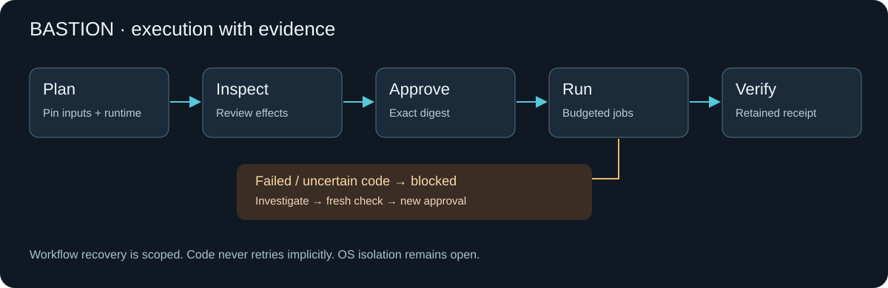
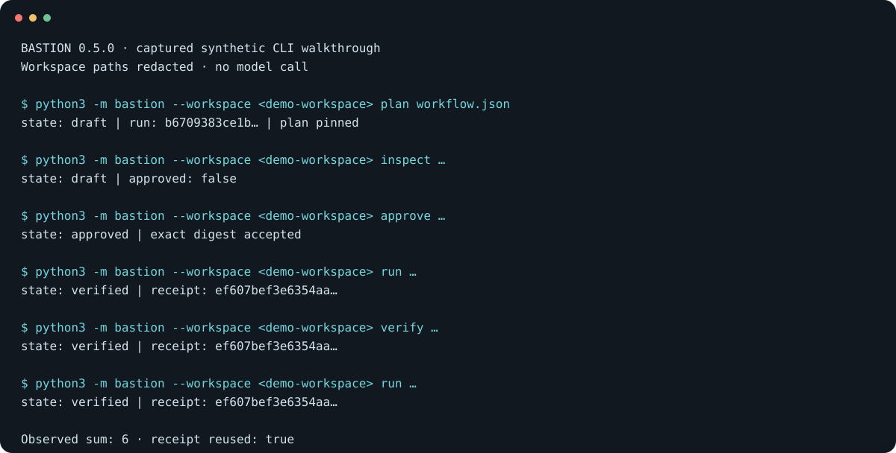

# BASTION

**Persistent work. Explicit authority. Evidence you can check.**


*Concept illustration, not a product screenshot. Bastion currently operates through a CLI and MCP.*

Bastion is a project-owned AI harness that carries knowledge, skills, plans and receipts across model sessions. Models propose work; the harness controls approved execution and retains what actually happened.

**0.5.0 · Mixed Mission Edition · local candidate**

## Start in one minute

Requires Python 3.9+ and a POSIX host. The standard-library workflow demo needs no provider account, API key or RF² binary. Native-backed qualification was performed on macOS ARM64; Linux remains unqualified until CI runs.

From an extracted checkout:

```sh
python3 -m bastion --workspace demo plan workflow.json
```

Read the returned plan, then substitute its exact run ID and digest:

```sh
python3 -m bastion --workspace demo inspect RUN_ID
python3 -m bastion --workspace demo approve RUN_ID PLAN_DIGEST
python3 -m bastion --workspace demo run RUN_ID PLAN_DIGEST
python3 -m bastion --workspace demo verify RUN_ID
```

The bundled demo ingests its own brief, recalls project knowledge, checks `1 + 2 + 3 = 6`, and records a verified receipt. It makes no model call. Repeating a finished run reuses that receipt.

For a fully scripted synthetic walkthrough:

```sh
python3 tools/docs_demo.py --run
```

That flag approves only the bundled disposable demo. It is not permission to execute arbitrary project code.

## What you get

| Feature | Current behavior |
|---|---|
| Project brain | Hash-checked knowledge, skill metadata, experience and reviewed lessons |
| Model continuity | Retained provider-neutral planner handoffs; supported provider-shaped proposal formats |
| Work graphs | Typed dependencies, exact plan approval and independently checked outputs |
| Cartridges | Immutable pure-workflow templates with qualification and baseline regression gates |
| Reviewed code checks | Pinned Python unittest jobs in separate worktrees with explicit operator approval |
| Mixed missions | Sequence workflows and checks; failed code blocks downstream work |
| Recovery | Reuse committed receipts; recover bounded workflows; never silently retry uncertain code |
| RF² | Optional pinned native checked-sum and decision gates; Python retains host authority |
| Storage controls | Observed state budgets and quota/TTL cleanup for explicitly rebuildable cache |
| MCP | 23 model-facing planning, inspection and bounded workflow tools |



## A walkthrough you can inspect



This is a rendering of an actual synthetic CLI capture with workspace paths redacted. It is not a graphical application screenshot. [Read the walkthrough](docs/WALKTHROUGH.md) or inspect the [captured JSON](docs/assets/walkthrough.json).

## Measured local speed

| Operation | Median of 15 local samples |
|---|---:|
| Plan → approve → run → verify | 210.28 ms |
| Reuse verified receipt | 50.42 ms |
| Brain query, no knowledge match | 48.38 ms |

Measured on macOS ARM64, Python 3.9.6. These include CLI process startup and local journal work on tiny fixtures; no native engine or model was configured for this timing run. They do not establish AI inference speed, throughput, production capacity or an advantage over another harness. [Method, ranges and raw samples](docs/PERFORMANCE.md).

## Proof and limits

- The retained local 0.5 suite passed **82 tests**, including process loss, recovery, tampering, typed mission checks and concurrent migration.
- A native-backed mixed pipeline passed, blocked a deliberately regressed kernel, refused implicit retry, and required fresh approval for correction.
- A separate WhatIF fixture returned expected statuses for 12 loopback probes; this established neither capacity nor security.

Reviewed code checks **are not OS-sandboxed** and retain host permissions. The host refused nested sandbox application. No live planner, generic MVP builder, installed scheduler or other-chat dispatcher is implemented. The installed RF² plugin was not upgraded by this source candidate.

The long-term goal is reliable bounded overnight work. Arbitrary MVP-by-morning delivery, infinite memory and AGI are not current capabilities.

## Documentation

- [Browser overview](docs/index.html) · [Validation scope](docs/VALIDATION.md)
- [Quick start and installation](docs/QUICKSTART.md)
- [Guided walkthrough](docs/WALKTHROUGH.md)
- [Features and boundaries](docs/FEATURES.md)
- [CLI, capabilities and MCP functions](docs/FUNCTIONS.md)
- [Measured speed](docs/PERFORMANCE.md)
- [Operator guide](docs/OPERATOR_GUIDE.md)
- [Architecture](architecture.md) · [0.5 release notes](RELEASE-0.5.0.md)
- [Contributing](CONTRIBUTING.md) · [Security boundaries](SECURITY.md)

## Local page preview

```sh
python3 -m http.server 8000 --bind 127.0.0.1 --directory docs
```

Open http://127.0.0.1:8000 . This serves the prepared overview locally; it does not publish a site.

## Development

```sh
PYTHONDONTWRITEBYTECODE=1 python3 -m unittest discover -s tests -v
```

Native-engine checks are conditional on a separately installed local RF² executable. Prepared GitHub Actions configuration is not a claim that hosted CI has run. Licensed under [MIT](LICENSE); see [NOTICE](NOTICE.md) for bundled-material boundaries.
