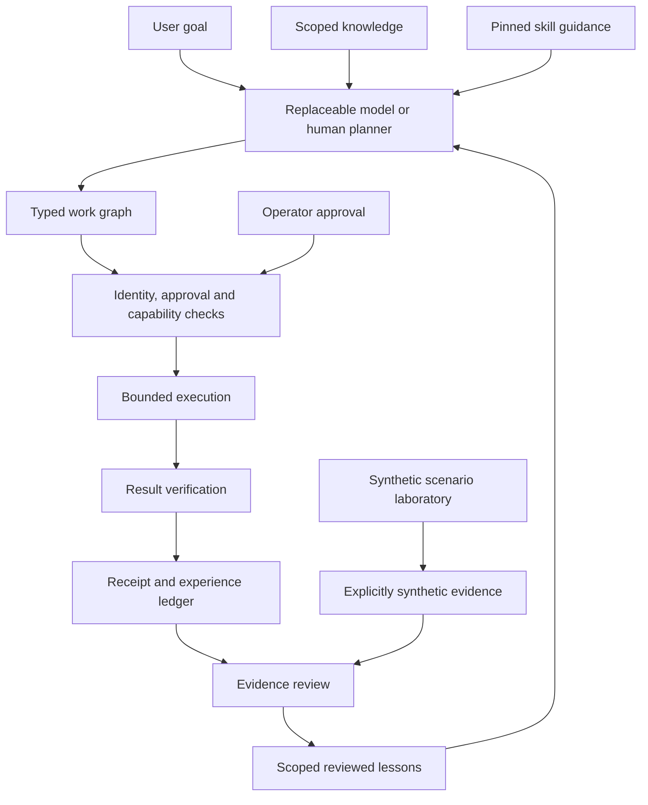

# BASTION as a persistent AI operating environment

The stable unit is a project-owned work graph and its evidence. Models are replaceable planners. Skills describe procedures. Capabilities are executable contracts. Knowledge supplies scoped context. Experience records observed outcomes; reviewed lessons can inform future proposals without gaining execution authority.

## Concrete acceptance scope

The implemented candidate is complete only within its declared contracts: a local model-neutral JSON workflow, seven trusted built-in capabilities, exact approvals, bounded project files, persistent knowledge, pinned skills, resumable execution, verified receipts, explicit lesson review, retained planner handoffs, qualified pure-workflow cartridges and a streamed synthetic laboratory.

The 0.2.0 cartridge layer adds immutable package/asset identity, typed input binding, positive/rejection qualification, explicit activation and baseline fixture replay before upgrades. Pure preflight and live execution enforce canonical-JSON output budgets. Asset pins, qualification identity and package identity are retained in approved execution plans. Qualification is local authored-fixture evidence, not model performance or general safety. The new data.select_fields capability supports bounded exact field projection and independently checks returned field membership and values.

“100% AI OS” is not a finite acceptance criterion. Release claims must be tied to a version, workload and proof level. A run can be verified without proving the model understands every task; a scenario can pass without establishing general safety; a large ledger can preserve experience without changing model weights.

## Release gates beyond the foundation

| Gate | Required evidence | Current state |
| --- | --- | --- |
| Native RF² integration | Exact typed contract, source/executable pins and parity tests | Candidate adapter executes real pinned gate/sum with independent checks; eight host-allowed transitions checked, installed plugin untouched |
| Host integration | Real allowed provider runs through two host adapters | Retained goal/context handoffs and stale-input checks implemented; two provider-shaped fixtures verified, no live provider calls |
| Isolation | Protected service identity and OS-denied filesystem/network boundary tests | Open: nested sandbox-exec refused by host (exit 71); reviewed code checks inherit host permissions |
| Reviewed code checks | Source/interpreter pins, explicit approval, actual unittest execution, time/output limits and receipts | Implemented in 0.4.0 for reviewed trusted code; no hostile-code isolation or mission auto-retry |
| WhatIF interoperability | Pinned real app/engine campaign, imported evidence and fresh verification | Actual WhatIF bounded-loopback smoke run against a synthetic mission-status fixture; 12 requests, no capacity/security verdict or browser-body qualification |
| Cross-platform release | Fresh installation, storage, locking and recovery qualification | Tested on this Mac only |
| Broad experience reuse | Indexed evidence retrieval, relevance evaluation, invalidation and human review | Bounded context graph with hash checks and reverified reviewed lessons implemented; literal search only, no semantic index or relevance evaluation |
| Deployment | User-selected destination and reviewed install artifact | Not installed or published |

The candidate now integrates the native RF² gate. The next gate is one isolated reviewed build/test capability, followed by a real planner/host connection. Model, agent and marketplace counts do not establish those capabilities.

## Mission Edition scope

The 0.3.0 candidate adds project-local durable batches, exact mission approval, future due times, deadline-prioritized polling, cross-process exclusion, parent-loss watchdogs, bounded idempotent recovery, output limits and observed state budgets. Native engine configuration remains an operator action and is pinned into plans. Rebuildable cache cleanup has a separate fresh digest gate; unique memory and receipts are preserved.

The 0.5.0 worker now sequences typed workflows and reviewed unittest jobs. Bounded workflows may recover idempotently; failed or uncertain code never retries implicitly. Committed passing check receipts can be adopted after controller loss. An investigated correction creates a new draft mission and approval, preserves lineage and cannot extend the original deadline/wall cutoff. OS-enforced isolation, a real model/host planner and explicitly authorized chat routing remain open. No LaunchAgent or cron task is installed and no background service is left running by qualification.
