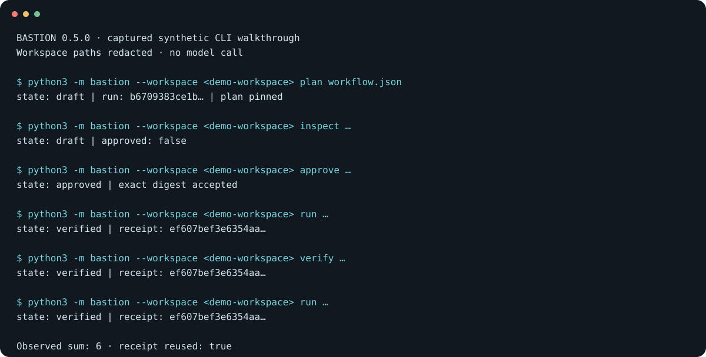
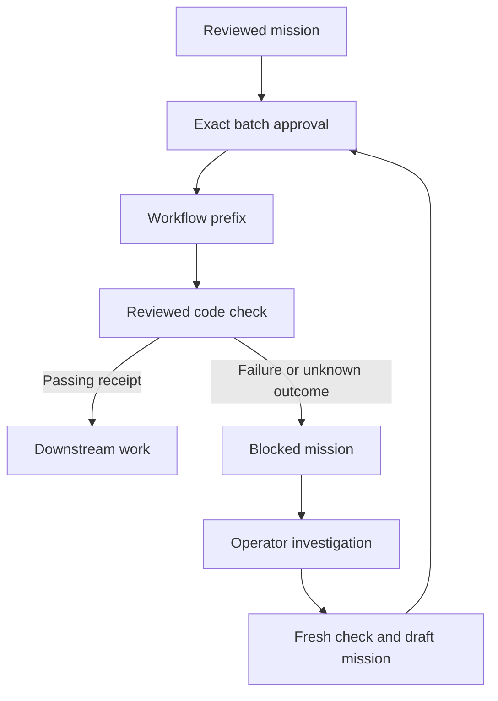

# Walkthrough

The illustrated capture uses the bundled six-node workflow. It is actual CLI output rendered as a terminal graphic, with workspace paths redacted. No model, browser or native engine is used in this demo.



1. **Plan.** Validate a dependency graph and pin runtime, inputs and registered skills. Nothing executes yet.
2. **Inspect.** Review the exact effects and hash. A provider label is provenance, not permission.
3. **Approve.** Authorize that exact plan digest through the operator CLI.
4. **Run.** Execute supported handlers and retain task evidence.
5. **Verify.** Recheck outputs, receipt and event integrity. The demo's sum is 6.
6. **Repeat.** Reuse the completed receipt rather than executing the finished work again.
7. **Recall.** Query the project brain without making its text executable authority.

## Mixed missions

A 0.5 mission's `jobs` array references exact digests with `kind: workflow` or `kind: check`. Both use the common `run` field for their identifier. The plan exposes code source pins, budgets and the absence of OS isolation.



Failed checks block downstream work. A passing receipt committed before controller loss can be adopted without rerunning code. Without that receipt, an interrupted check requires investigation. A replacement is a new draft, requires new approval and cannot extend the original deadline/wall cutoff. The operator's reason does not prove external reconciliation.

```sh
python3 -m bastion --workspace PROJECT mission plan mission.json
python3 -m bastion --workspace PROJECT mission inspect MISSION_ID
python3 -m bastion --workspace PROJECT mission approve MISSION_ID DIGEST
python3 -m bastion --workspace PROJECT mission work MISSION_ID DIGEST
```

See the operator guide for the full JSON schema example and `mission replace-check` syntax. No scheduler or host-chat dispatcher is installed by these commands.

## What the images mean

The cover is generated concept artwork. The workflow graphic is an exact authored diagram. The terminal graphic is rendered from captured CLI results. None is presented as a native application UI screenshot.
